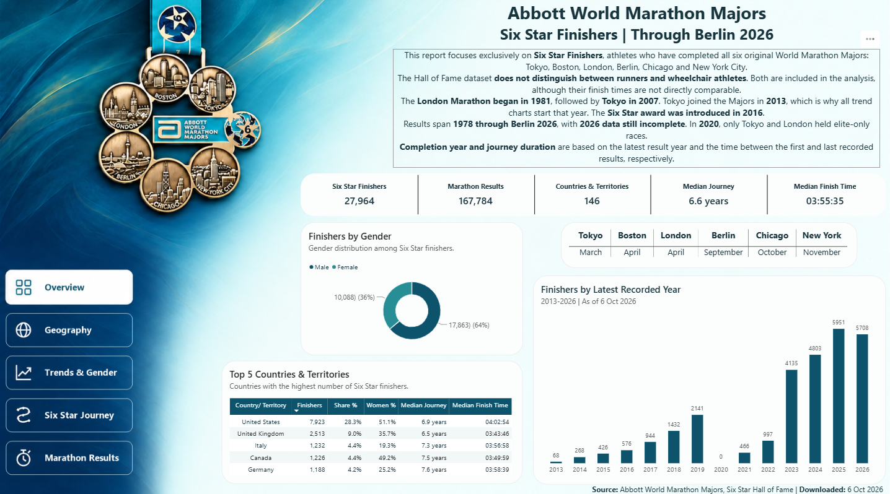
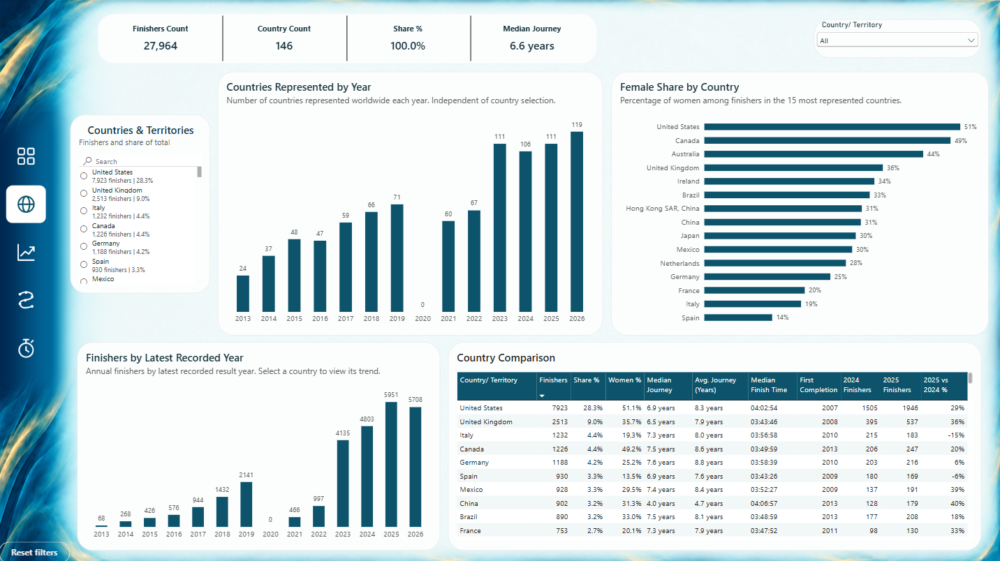
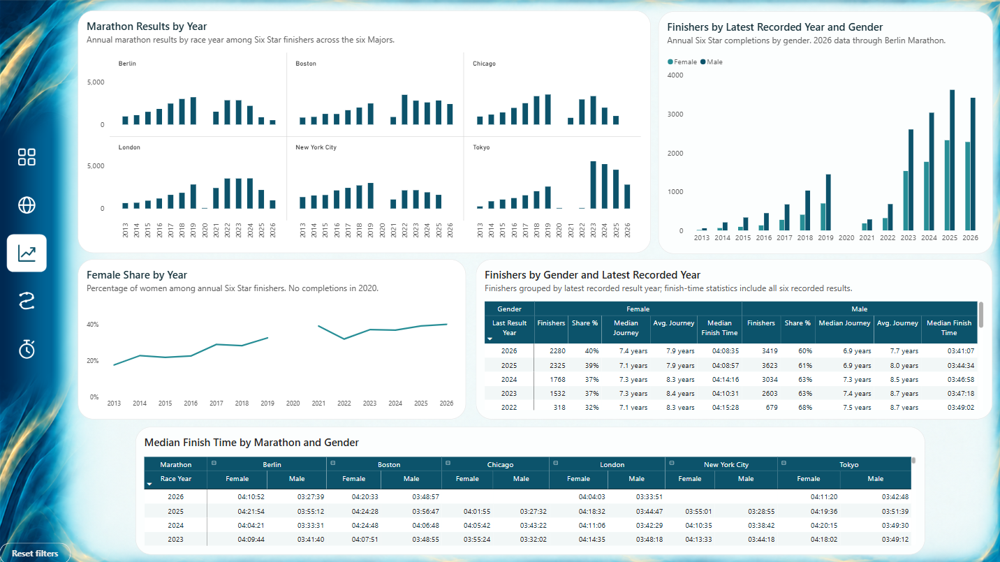
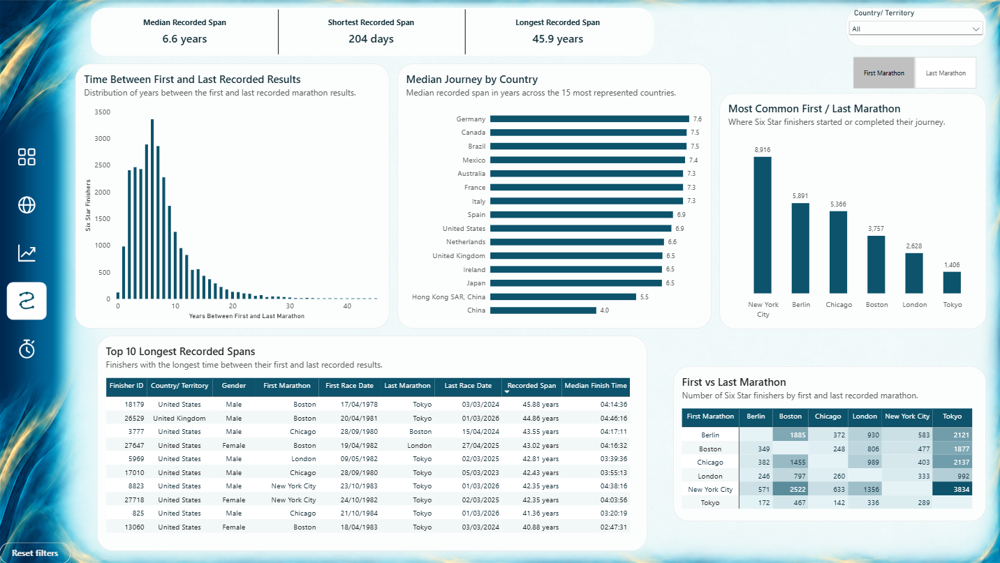
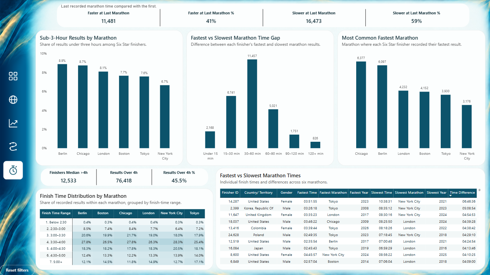

# Six Star Finishers Analysis

[Wersja polska](README_PL.md)

[View Interactive Power BI Dashboard](https://app.fabric.microsoft.com/view?r=eyJrIjoiZGFmZWRkOWMtZTE2Zi00MTM2LTkwODctNmRjZGRmOWVlMmVmIiwidCI6IjI3ZWI2YjZjLWRhZWQtNDFkMS05NTJhLTM0ZDY0MjgzZWFhNSJ9&embedImagePlaceholder=true)

## Project Overview

This project presents an analysis of **27,964 Six Star Finishers**, athletes who have completed all six original Abbott World Marathon Majors:

- Tokyo Marathon
- Boston Marathon
- London Marathon
- Berlin Marathon
- Chicago Marathon
- New York City Marathon

The analysis covers **167,784 marathon results** from athletes representing **146 countries and territories**.

The project combines **Python, Power BI, Power Query and DAX**. Python was used to collect, prepare and validate the data, while Power BI was used for data modeling, analysis and interactive reporting.

The main goal of the project was to investigate:

- how the number of Six Star Finishers changed over time,
- which countries and territories have the highest representation,
- how the proportions of women and men have changed,
- how much time elapsed between athletes' first and last recorded marathon results,
- which marathons most frequently appear as the first and last in athletes' recorded results,
- at which marathons athletes achieved their fastest times,
- how finish times are distributed across the six marathons,
- how much athletes' fastest and slowest recorded marathon times differ.

The Power BI report consists of **five interactive pages**, covering an overview of the dataset, geography, trends and gender, recorded journey duration, and marathon performance.

## Data Source

The data comes from the official **Abbott World Marathon Majors Six Star Hall of Fame**.

**Source:** https://www.worldmarathonmajors.com/six-star/hall-of-fame

**Data downloaded:** 6 October 2026  
**Project published:** 16 October 2026  
**Data coverage:** 1978–2026, through the Berlin Marathon

Key dataset statistics:

- **Six Star Finishers:** 27,964
- **Marathon Results:** 167,784
- **Countries & Territories:** 146
- **Median Recorded Span:** 6.6 years
- **Median Finish Time:** 03:55:35

Each athlete has one recorded result from each of the six marathons. The dataset does not represent the complete history of all marathon races completed by these athletes.

**Important data limitation:** The Hall of Fame dataset does not distinguish between runners and wheelchair athletes. Both groups are included in the analysis, although their marathon finish times are not directly comparable.

### Historical Context

The first **London Marathon took place in 1981**, followed by the first **Tokyo Marathon in 2007**. Tokyo joined the World Marathon Majors in **2013**, which is why all trend charts begin in that year.

The **Six Star award was introduced in 2016**.

In **2020**, due to the COVID-19 pandemic, only Tokyo and London held elite-only marathon races.

### 2026 Data Status

The **2026 dataset is incomplete** and includes results through the Berlin Marathon 2026.

The **Chicago Marathon took place on 11 October 2026**, but its results were not yet included in the dataset used for this analysis. The **New York City Marathon is scheduled for 1 November 2026**.

**The report is planned to be updated after the New York City Marathon 2026**, once the relevant data becomes available in the Hall of Fame.

## Data Collection and Preparation in Python

**Python in Google Colab** was used to collect and prepare the data.

[View Data Preparation Notebook](Python/six_star_finishers.ipynb)

### Data Collection

The data was retrieved from the public Hall of Fame search endpoint using the `requests` library.

The query applied the condition `total_stars = 6` to retrieve records for athletes who had earned all six stars.

Because the dataset exceeded the standard 10,000-result limit, **`search_after` pagination** was used to retrieve the data in batches of **1,000 records**.

During the download process:

- records were sorted by athlete identifier,
- the total number of records reported by the source was monitored,
- the reported total was compared with the number of downloaded records,
- the completeness of the download was checked.

A total of **27,964 athlete records** were retrieved.

### Data Preparation

The `pandas` library was used to transform the downloaded data.

The source records were separated into two related tables:

**`finishers`**

A table containing athlete information, including identifiers, gender, and represented country or territory.

**`marathon_results`**

A table containing six recorded marathon results for each athlete, including marathon name, race date, and finish time.

The preparation process included:

- preserving athlete and source record identifiers,
- standardizing field names and structure,
- resolving full country and territory names using the source nationality dictionary,
- preserving the original finish-time values,
- converting finish times into seconds for further calculations,
- adding a data download timestamp.

### Data Validation

Data quality and consistency checks were performed before exporting the prepared tables.

The validation process included checking:

- consistency between downloaded record counts and source totals,
- uniqueness of identifiers,
- the presence of six distinct marathons for each athlete,
- relationships between athletes and their results,
- missing and invalid values,
- validity of marathon dates and finish times,
- consistency of the final result count.

After validation, the dataset contained:

- **27,964 athletes**
- **167,784 marathon results**

All validation checks passed successfully.

### Data Export

The prepared data was exported into two CSV files:

- `finishers.csv`
- `marathon_results.csv`

These files were subsequently used to build the Power BI data model.

### Marathon Calendar Preparation

An additional CSV file containing the dates of individual editions of the six marathons was prepared separately. **All dates were verified** before being incorporated into the report. The calendar supports the analysis of results by marathon, race date, and year.

## Data Model

The data was imported into **Power BI**, where a relational model was created using a fact table and supporting dimension tables.

**Fact table:**

- **`fMarathon_Results`** – recorded results from the six marathons for each athlete.

**Dimension tables:**

- **`dFinishers`** – information about Six Star Finishers.
- **`dMarathons`** – marathon dimension.
- **`dMarathon_Dates`** – dates of individual marathon editions.
- **`dCalendar`** – calendar dimension supporting time-based analysis.

The model supports analysis by athlete, country or territory, gender, marathon, and year.

Additional fields were prepared in Power Query and the data model to support grouping, filtering, sorting, and analytical calculations.

## DAX Measures

DAX measures were developed to support analysis and dynamic comparisons throughout the report.

The calculations include:

- the number of finishers and marathon results,
- the number of represented countries and territories,
- each country's share of the total finisher population,
- the proportions of women and men,
- the number of finishers by latest recorded result year,
- median and average time between first and last recorded results,
- median marathon finish time,
- women's and men's results by marathon and year,
- the share of marathon results under three hours,
- the most common fastest marathon,
- differences between fastest and slowest recorded results,
- comparisons of first and last recorded marathon times.

The measures support analysis across different filter contexts and comparisons between selected groups of athletes.

## Dashboard Pages

### 1. Overview

The Overview page introduces the analysis and presents the main characteristics of the Six Star Finishers dataset.

The main KPIs include:

- Six Star Finishers
- Marathon Results
- Countries & Territories
- Median Journey
- Median Finish Time

The page also presents:

- the gender distribution of finishers,
- the five countries and territories with the highest number of Six Star Finishers,
- women's share and median marathon times in these countries,
- a calendar of the six marathons,
- annual finisher trends based on the latest recorded result year.

It also provides information about World Marathon Majors history, the data source, and methodological limitations.



### 2. Geography

The Geography page focuses on the geographic distribution of Six Star Finishers.

It includes analysis of:

- the number of finishers from individual countries and territories,
- each country's percentage share of the dataset,
- the number of represented countries across different years,
- women's share among finishers from the 15 most represented countries,
- annual finisher trends for a selected country,
- median and average time between first and last recorded results,
- median marathon finish times,
- finisher counts for 2024 and 2025, including year-over-year changes.

Interactive filters allow users to explore and compare results for selected countries or territories.



### 3. Trends & Gender

The Trends & Gender page explores changes over time and differences between women and men.

The analysis includes:

- annual recorded results for each of the six marathons,
- the number of women and men by latest recorded result year,
- changes in women's percentage share,
- median and average time between first and last recorded results,
- median marathon finish times for women and men,
- finish-time comparisons across marathons by race year.

The analysis distinguishes between the year in which a particular marathon took place and the latest recorded result year assigned to an athlete.



### 4. Six Star Journey

The Six Star Journey page analyzes the time between each athlete's first and last recorded marathon results.

The main KPIs include:

- **Median Recorded Span:** 6.6 years
- **Shortest Recorded Span:** 204 days
- **Longest Recorded Span:** 45.9 years

The page presents:

- the distribution of finishers by recorded span,
- median recorded span for the 15 most represented countries,
- the most common first and last recorded marathons,
- a ranking of the ten longest recorded spans,
- combinations of first and last recorded marathons.

The First Marathon / Last Marathon selector allows users to switch between the two perspectives.

The recorded span is calculated from the six available results and does not necessarily represent an athlete's complete marathon history.



### 5. Marathon Results

The Marathon Results page focuses on the marathon performance of Six Star Finishers.

It presents:

- comparisons between first and last recorded marathon times,
- the percentage of results under three hours for each marathon,
- the number of finishers whose median finish time across six recorded marathons exceeds four hours,
- the percentage of all recorded marathon results exceeding four hours,
- the distribution of time differences between each athlete's fastest and slowest recorded results,
- a ranking of marathons where athletes most frequently achieved their fastest times,
- the percentage distribution of marathon finish times,
- detailed comparisons of athletes' fastest and slowest recorded results, including the year of each race.

The comparison between first and last recorded marathon times showed that:

- **11,481 athletes (41%)** recorded a faster time in their last marathon,
- **16,473 athletes (59%)** recorded a slower time in their last marathon.

Ten athletes recorded identical times in both compared results.

Additionally, **12,533 finishers** had a median finish time exceeding four hours across their six recorded marathons, while **45.5% of all recorded marathon results** exceeded four hours.



## Key Findings

The analysis highlights several key findings:

1. **The United States has the largest representation**, with 7,923 finishers, accounting for 28.3% of the dataset.

2. **Women's representation has increased over time**, reaching approximately 40% in 2026.

3. **The median time between the first and last recorded marathon results is 6.6 years**, although individual recorded spans vary considerably.

4. **New York City is the most common first recorded marathon** among the six results associated with each athlete.

5. **Chicago and Berlin are the most common fastest marathons**, with 6,377 and 6,097 athletes, respectively, achieving their fastest recorded time at these events.

6. **The most common difference between an athlete's fastest and slowest recorded marathon times is 30–60 minutes**.

7. **Most athletes recorded a slower time in their last recorded marathon than in their first**.

8. **Berlin has the highest share of results under three hours**, at 8.9%.

All findings refer exclusively to the athletes and marathon results available in the analyzed Six Star Hall of Fame dataset.

## Methodology and Limitations

Several limitations of the source data should be considered when interpreting the results.

### Scope of Analysis

The report includes only athletes listed in the Six Star Hall of Fame, not all participants in the World Marathon Majors.

### Completion Year

The year assigned to each athlete is determined by **the latest year among their six recorded marathon results**.

This does not necessarily represent the year in which the athlete first completed all six marathons or received the Six Star award.

### Journey Duration

The recorded span is calculated as the difference between the dates of the first and last available marathon results.

It does not represent the athlete's complete sporting career.

### Gender

The source contains a small number of records with an unspecified gender category. Analyses comparing women's and men's shares use the Female and Male groups.

### Finish Times

The recorded marathon finish times also include wheelchair athletes. Because the source does not identify the athletic category, wheelchair results cannot be separated from runners' results.

### Data Updates

The Hall of Fame is a continuously updated source. Downloading the data again may return a different number of records.

All results in this report are based on the dataset downloaded on **6 October 2026**.

## Tools & Technologies

- **Python** – data collection, preparation, and validation
- **requests** – data retrieval from the public endpoint
- **pandas** – data transformation and export
- **Google Colab** – notebook development environment
- **Power BI Desktop** – data modeling, analysis, and visualization
- **Power Query** – data preparation for the model
- **DAX** – analytical measures and dynamic calculations
- **CSV** – data preparation and exchange
- **GitHub** – project documentation and presentation

## Repository Structure

```text
six-star-finishers-analysis/
│
├── Python/
│   ├── six_star_finishers.ipynb
│   └── requirements.txt
│
├── Screenshots/
│   ├── 01_overview.png
│   ├── 02_geography.png
│   ├── 03_trends_gender.png
│   ├── 04_six_star_journey.png
│   └── 05_marathon_results.png
│
└── README.md
```

The `six_star_finishers.ipynb` notebook documents the process of downloading, preparing, and validating the data.

The `requirements.txt` file lists the Python libraries required to run the notebook.

The `Screenshots` folder contains images of the five Power BI report pages.

## Source

**Abbott World Marathon Majors – Six Star Hall of Fame**

https://www.worldmarathonmajors.com/six-star/hall-of-fame

**Data downloaded:** 6 October 2026  
**Project published:** 16 October 2026  
**Report coverage:** Through Berlin Marathon 2026

The report is planned to be updated once data from the remaining 2026 marathon events becomes available.
